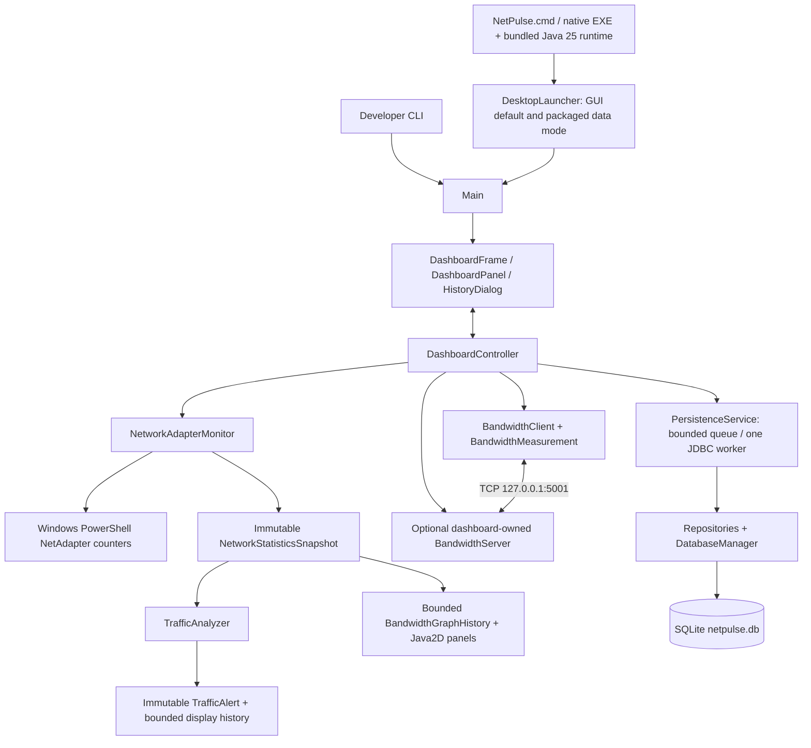
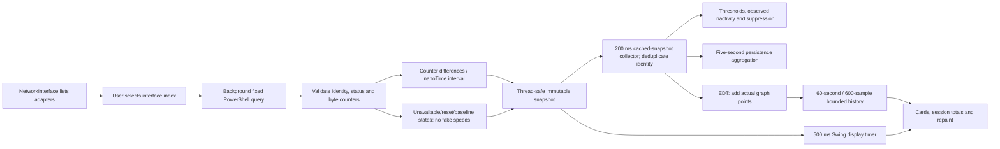
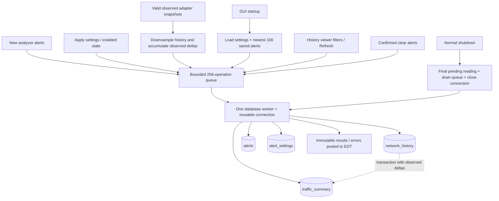

# NetPulse architecture diagrams

These diagrams describe the implemented application. Arrows show method calls
or immutable data being passed between components, not packet capture.

## Overall system architecture



Swing components and graph history are updated on the Event Dispatch Thread.
The generated native EXE was blocked by signing policy on the verification
machine; the supplied batch launcher uses the bundled vendor-signed Java runtime.
PowerShell, TCP transfers, server lifecycle, analysis and SQLite work run in
background tasks. SQLite stores adapter readings, not TCP test payload results.

## TCP client-server communication

```mermaid
sequenceDiagram
    participant GUI as GUI / CLI caller
    participant C as BandwidthClient
    participant S as BandwidthServer
    GUI->>C: transfer(mode, expected bytes)
    C->>S: TCP connect to 127.0.0.1:5001
    C->>S: UTF UPLOAD/DOWNLOAD + long expected bytes
    S-->>C: UTF READY (or ERROR)
    Note over C: System.nanoTime measurement starts after READY
    alt UPLOAD
        C->>S: Exact payload, 64 KiB buffer
        C->>S: Half-close output (EOF)
        S->>S: Check byte count and EOF
        S-->>C: UTF COMPLETE + long received count
    else DOWNLOAD
        S-->>C: Exact payload, 64 KiB buffer
        S-->>C: Half-close output (EOF)
        C->>C: Check byte count and EOF
        C->>S: long received count
    end
    C->>C: Finish measurement; exclude protocol bytes
    C-->>GUI: Immutable TransferResult / error
    Note over C,S: One transfer per connection; sockets close afterward
```

The GUI can start/stop its own server. The server can also run in a separate
process using the unchanged developer CLI. Localhost throughput is not Internet
capacity and usually does not traverse the physical Wi-Fi/Ethernet adapter.

## Network monitoring data flow



The collector never launches extra PowerShell commands. Stop captures the
monitor's final published reading before flushing persistence; graph samples
and the time axis freeze. Unknown readings create gaps rather than zeros.

## Database interaction



Packaged data path: `%LOCALAPPDATA%\NetPulse\netpulse.db`, with a user-home
local-data fallback. Developer data path: `data/netpulse.db`. Explicit test
paths take precedence. Retention is opt-in, defaults to 30 days when enabled,
and affects only old detailed network-history rows.
