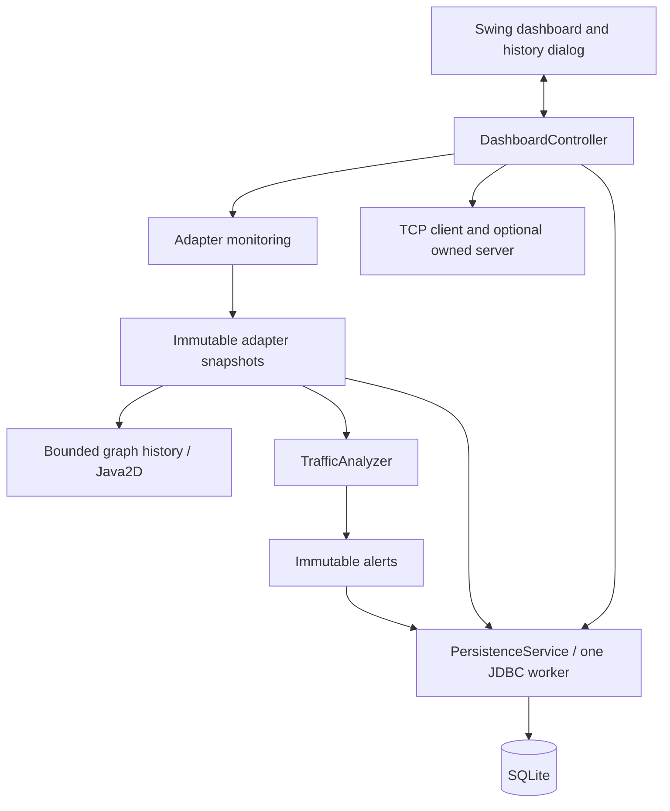
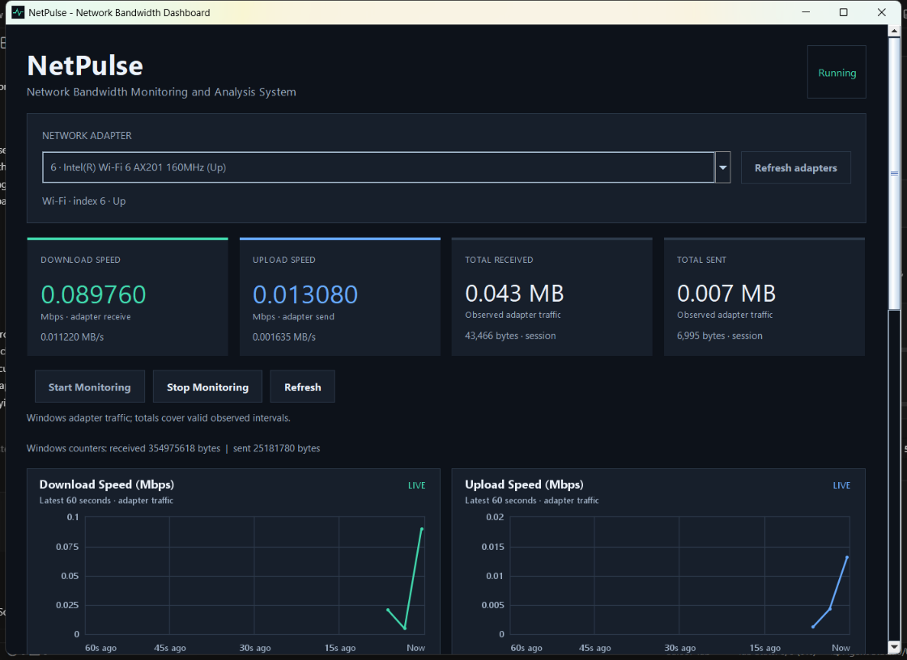
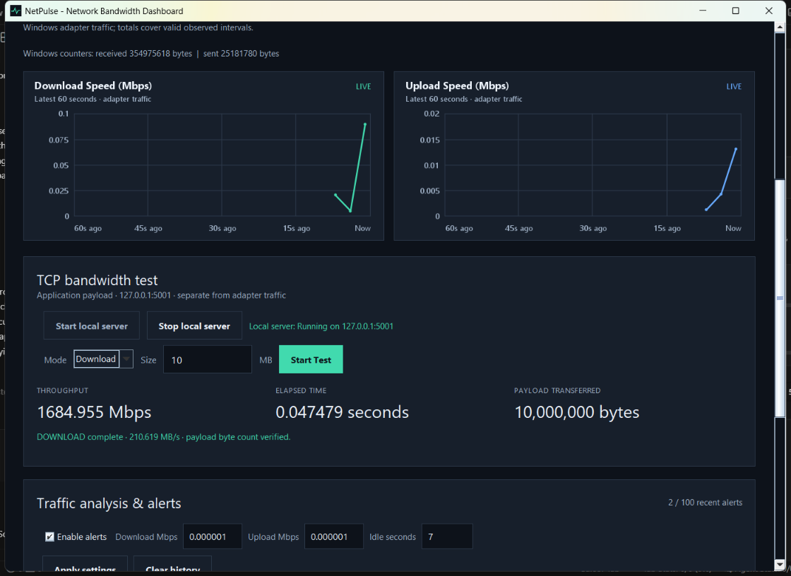
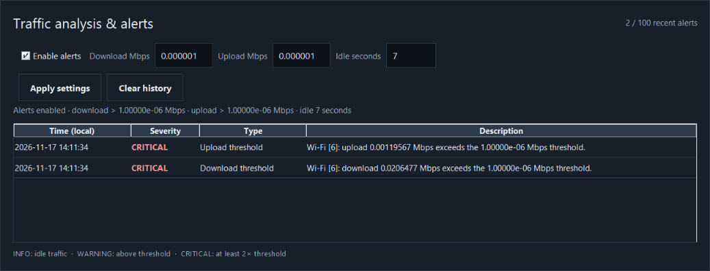
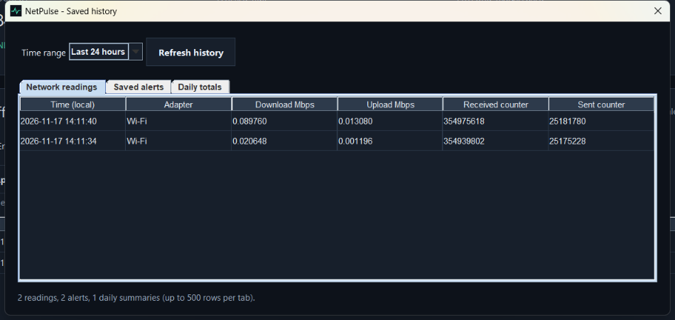

# NetPulse
## Network Bandwidth Monitoring and Analysis System

**Computer Networks Mini Project / College Submission**

| Field | Editable submission information |
|---|---|
| Student name | [Enter student name] |
| USN / registration number | [Enter USN] |
| Department and semester | [Enter department and semester] |
| College / institution | [Enter college name] |
| University | [Enter university name] |
| Project guide | [Enter guide name and designation] |
| Academic year | [Enter academic year] |
| Submission date | [Enter submission date] |
| Application version | NetPulse 1.0.0, Windows x64 |

This report describes the implementation in the accompanying source and release.
Complete the editable academic fields before submission. Diagrams are maintained
as Mermaid text in [ARCHITECTURE.md](ARCHITECTURE.md); screenshots are genuine
Windows application captures in [screenshots](screenshots/).

## 1. Abstract

NetPulse is a desktop application for observing network adapter traffic and
demonstrating TCP bandwidth measurement. It combines Java socket programming,
monotonic timing, concurrent background execution, a Swing dashboard, Java2D
graphs, configurable alerts and SQLite persistence. Java identifies adapters;
Windows PowerShell supplies cumulative receive/send byte counters that the
standard Java interface API does not expose. Differences between successive
valid counters produce interval-average speeds. Separate localhost TCP tests
transfer and verify actual payload bytes with a 64 KiB buffer.

The dashboard keeps networking and database operations outside the Swing Event
Dispatch Thread. A bounded graph window and alert display prevent unbounded
in-memory growth. Monitoring records, observed daily totals, alerts and settings
are stored locally. The Windows release uses `jpackage` to bundle a Java runtime
and a native launcher. The project demonstrates Computer Networks concepts
without presenting application payload throughput as whole-system traffic or
claiming that an idle adapter proves an Internet disconnection.

## 2. Introduction

Network bandwidth is often described using a single speed number, although
several different measurements are involved. An adapter's transferred bytes,
an application's useful TCP payload rate, and a link's theoretical capacity
describe different things. A network may also be idle while fully connected.
An educational tool should show these distinctions and expose the measurement
process rather than display simulated results.

NetPulse provides one selected-adapter view and an independent TCP experiment.
Students can observe actual Windows traffic, generate activity using ordinary
applications, run upload/download tests, inspect time-series graphs, configure
thresholds and examine records after restarting. TCP tests initially use
127.0.0.1 so a single Windows computer is sufficient for the demonstration.

## 3. Problem statement

Develop a beginner-readable Java desktop system that measures real network
activity, presents useful statistics without blocking the GUI, handles missing
readings and connection failures, and preserves monitoring evidence locally.
The implementation must separate adapter counters from generated TCP traffic,
verify transferred byte counts and close sockets, processes, workers and JDBC
resources reliably.

## 4. Objectives

1. Discover and select network adapters using Java's `NetworkInterface` API.
2. Obtain actual Windows receive/send counters and calculate independent speeds.
3. Display measured Mbps, MB/s and valid observed session totals.
4. Demonstrate TCP request/response, streams, payload transfer and EOF handling.
5. Calculate current, average and peak TCP throughput from bytes and elapsed time.
6. Keep the dashboard responsive through background execution and safe EDT updates.
7. Draw two scrolling 60-second adapter-speed graphs without a chart dependency.
8. Generate configurable threshold/inactivity alerts with suppression and history.
9. Persist actual readings, observed daily totals, alerts and settings in SQLite.
10. Supply a Windows launcher with a bundled runtime and usable submission documents.

Internet capacity estimation, packet capture, remote authentication, latency and
packet-loss measurement are not implemented objectives of this release.

## 5. Existing system and proposed system

Windows already provides adapter information through system utilities and
PowerShell. Standalone transfer utilities can report application throughput.
These tools are useful but do not necessarily expose a small, understandable
Java implementation that connects TCP, measurement, visualization and local
history for a college demonstration.

The proposed NetPulse system combines those educational workflows in a modular
application. It reuses Windows counters instead of claiming to capture all
packets with Java. A separate TCP client/server experiment makes the byte and
time calculations inspectable. Local persistence supports repeat demonstrations
without requiring accounts, a database server or a cloud service.

## 6. Hardware and software requirements

| Requirement | Development / verification | Running the release |
|---|---|---|
| OS / architecture | Windows 11 x64 | Windows 11 x64 |
| Java | JDK 25 with `javac`, `jpackage` and `jlink` | Runtime bundled in application folder |
| Build tool | Maven | Not required |
| IDE | VS Code or another Java editor | Not required |
| Adapter source | Windows PowerShell and NetAdapter module | Same Windows components |
| Database | SQLite JDBC dependency | JDBC JAR and native resources included |
| Display | Interactive desktop; tested at 860×600 and larger | Window can resize; vertical scrolling available |
| Network | Active supported adapter for traffic demonstration | Same; localhost TCP tests require no external host |

A normal Windows laptop is sufficient. A dual-core CPU and 4 GB RAM are
reasonable demonstration guidelines, not measured minimum requirements. Allow
disk space for the extracted application, ZIP and growing history; actual
release sizes are recorded in the release verification document. Ordinary
localhost operation does not require administrator rights. Driver support,
PowerShell permissions and institutional policies can affect adapter queries.

## 7. Technologies used

- **Java 25:** application language, records, streams, virtual/background threads.
- **Maven:** dependency management, compilation, JUnit execution and release JAR.
- **Swing:** frame, controls, cards, tables, dialogs and periodic display timer.
- **Java2D:** custom antialiased line graphs, axes and labels.
- **Java sockets / TCP/IP:** client/server transfers using loopback IPv4.
- **ExecutorService:** adapter collection, TCP work, analysis and storage tasks.
- **SQLite JDBC 3.50.3.0:** embedded persistence using prepared statements.
- **JUnit Jupiter 5.13.4:** deterministic, socket, lifecycle and desktop tests.
- **Windows PowerShell:** fixed `Get-NetAdapterStatistics` invocation.
- **jpackage / jlink:** native Windows launcher and selected-module runtime image.

No Spring Boot, web server framework, charting library, cloud service or external
notification dependency is used.

## 8. System architecture



Responsibilities are divided into `network`, `monitoring`, `model`, `ui` and
`database`. The reserved `alerts` package is currently empty; actual detection
is in `monitoring.TrafficAnalyzer`, and its immutable alert model is in `model`.
The application does not introduce a framework merely to fill every package.

The EDT owns Swing components and graph history. Background work publishes
immutable results, then schedules component changes with
`SwingUtilities.invokeLater`. A 500 ms Swing timer displays cached statistics.
The collector polls only the monitor's snapshot every 200 ms; it does not
perform extra Windows queries. A separate storage queue isolates JDBC latency
from collection. The four detailed maintained diagrams are in
[ARCHITECTURE.md](ARCHITECTURE.md).

## 9. Module descriptions

| Module / classes | Implemented responsibility |
|---|---|
| `Main` | Existing `gui`, `server`, `client`, `adapters`, `monitor` commands |
| `DesktopLauncher` | Packaged GUI default and per-user application-data mode |
| `BandwidthServer`, `BandwidthClient`, `TransferProtocol` | Request validation, sockets, exact payload transfer, timeout/error handling |
| `BandwidthMeasurement`, `BandwidthSnapshot`, `TransferResult` | Reusable actual-byte measurement and immutable results |
| `NetworkAdapterMonitor`, `WindowsAdapterStatistics` | Adapter discovery, Windows counters, valid-delta calculations, source lifecycle |
| `NetworkStatisticsSnapshot`, `NetworkAdapter` | Immutable adapter identity, state, optional counters and measured rates |
| `DashboardFrame`, `DashboardPanel`, `DashboardStyle` | Window lifecycle, consistent dark components and rendering |
| `DashboardController` | Background orchestration, safe UI updates, optional local server ownership |
| `BandwidthGraphHistory`, `BandwidthGraphPanel` | Bounded sample window and two Java2D graphs |
| `TrafficAnalyzer`, `AlertSettings`, `TrafficAlert`, `AlertPanel` | Thresholds, observed inactivity, suppression, settings and recent-alert display |
| `DatabaseManager`, repositories, `PersistenceService` | Schema, prepared queries, queued persistence, retention and cleanup |
| `HistoryDialog` | Filtered recent readings, persisted alerts and daily totals |

## 10. TCP client-server communication

The server binds only to **127.0.0.1:5001**. The dashboard can start/stop its own
server in background tasks. It reports an occupied port and never terminates
another program's server. Closing the dashboard stops only the server it owns.
The developer CLI can still run the server and clients as separate processes.

One connection serves one request:

1. Client sends a UTF operation (`UPLOAD` or `DOWNLOAD`) and a signed 64-bit
   payload length. Valid sizes are 1 byte through 1 GiB.
2. Server validates the request and sends `READY`, or an error.
3. Sender writes exactly the requested payload using a **64 KiB buffer** and
   half-closes its output. The receiver verifies both count and EOF; short or
   oversized payloads fail.
4. Upload completion returns `COMPLETE` and the server's received count.
   Download completion returns the client's received count.
5. Sockets close using try-with-resources.

The payload is zero-filled test data that is actually transferred through TCP;
its contents are not a simulation of speed. TCP provides ordered reliable byte
streams, not application message boundaries, so the explicit length and EOF
checks are part of the application protocol. A three-second connect timeout,
five-second read inactivity timeout and 60-second overall deadline limit stalls.
Closing the socket at the deadline also unblocks a blocked write. The server
uses four client workers and a bounded queue of four additional requests.

## 11. Bandwidth measurement methodology

Client elapsed time starts after `READY`, using `System.nanoTime()`. It covers
payload transfer/completion and the confirmation exchange, while excluding
connection setup and request validation. Successful payload reads/writes update
the measurement. Headers and acknowledgements do not contribute payload bytes.
The client only reports success after the exact count is verified.

```text
seconds              = elapsed nanoseconds / 1,000,000,000
average bytes/second = total payload bytes / seconds
current bytes/second = bytes since previous measurement sample / interval seconds
peak bytes/second    = greatest sampled current rate
MB/s                 = bytes/second / 1,000,000
Mbps                 = MB/s × 8
progress             = min(100, transferred / expected × 100)
```

Current and peak samples normally update after at least 100 ms; finish also
evaluates a shorter final interval. Average is total bytes divided by total
elapsed time, not an unweighted average of rates. Empty reusable measurements
have zero rates, invalid sizes/times are rejected, unknown expected size has no
percentage and progress is capped at 100%. A known zero expected size represents
an empty completed payload in the engine; TCP requests themselves require a
positive size. Finished snapshots are immutable and stable.

The GUI size `10` MB means **10,000,000 bytes**. The CLI example `10485760` bytes
means **10 MiB**, approximately 10.49 decimal MB. Very short loopback transfers
are scheduling-sensitive and may show rates far above Wi-Fi link speed. These
rates describe application TCP payload throughput, not Internet capacity.

## 12. Network adapter monitoring methodology

`NetworkInterface` identifies adapter index, name, description and Up/Down state,
but does not provide traffic byte counters. A fixed noninteractive PowerShell
command selects a validated numeric interface index and runs
`Get-NetAdapterStatistics`. Interface names are never concatenated into shell
code. The helper validates the index, GUID, status and signed-long byte counters;
names use UTF-8/Base64 in a small delimited response.

The monitor samples on a background worker with a two-second delay after each
completed query. PowerShell startup/query time adds overhead, so real intervals
are commonly about three seconds. The actual elapsed interval comes from
`System.nanoTime()`, not an assumed timer rate:

```text
receive delta = current received counter − previous received counter
send delta    = current sent counter − previous sent counter
receive speed = receive delta / actual elapsed seconds
send speed    = send delta / actual elapsed seconds
session total = sum of valid observed deltas
```

The first reading establishes a baseline. Unavailable adapters, command failures,
counter resets, identity changes and nonpositive intervals do not produce fake
speeds. Recovery requires a safe baseline, and unknown intervals are excluded.
An unchanged valid counter pair produces a measured zero. OS cumulative counters
can include traffic before NetPulse starts; session totals cannot.

The latest immutable snapshot is published through a volatile field. Stopping
cancels sampling, interrupts the worker, terminates an active PowerShell query,
retains the final real published reading for persistence and exposes a stopped
snapshot without current speeds. A PowerShell query has a five-second timeout.

## 13. GUI and graph implementation

The dark dashboard contains a title/status header, adapter selector, live speed
and total cards, monitoring controls, two graphs, independent TCP test controls,
local-server controls, alert configuration/history and a history-viewer button.
Long tasks never run on the EDT. Virtual-thread TCP tasks can be interrupted
during shutdown without rewriting the socket protocol.

The Java2D panels draw separate Download Speed and Upload Speed lines. An
`ArrayDeque` holds at most **600** sample pairs and approximately the newest
**60 seconds**. Samples older than the window are evicted as data arrives or
the running graph paints. Axis scaling adapts to measured values and resizing.
Antialiasing and rounded line segments improve readability without smoothing
away actual measurements. Unavailable values break the line; a valid zero is
plotted at zero. No last-value extension fabricates data between measurements.

Stop freezes the graph and time axis. A new monitoring session clears graph
data. A scrollable layout keeps all sections accessible on laptop screens.
Screenshots are actual measurements, not generated illustrations:





## 14. Traffic analysis and alert system

The synchronized `TrafficAnalyzer` processes each new actual adapter snapshot
outside the EDT. Defaults are alerts **disabled**, download **100 Mbps**, upload
**50 Mbps**, inactivity **30 seconds**. These are demonstration warning limits,
not an automatically detected capacity. Applying settings and changing enabled
state persist the active values. Invalid text leaves the previous configuration;
disabling remains possible even if an unapplied field is invalid.

| Condition | Severity | Suppression |
|---|---|---|
| Speed strictly above the configured threshold | WARNING | One alert for that direction until a valid below/equal reading clears it |
| Speed at least twice the threshold when first exceeded | CRITICAL | Same active-condition suppression |
| Both directions remain exactly zero for the configured valid observed duration | INFO | Rearmed when actual traffic resumes |

Unavailable samples do not prove a threshold cleared and do not accumulate
idle time. INFO describes inactivity without asserting disconnection. Session
changes and changed settings reset detection state. Clearing displayed history
does not rearm an active condition. Immutable alerts contain timestamp, type,
severity and description. Only the newest **100** are retained for display;
SQLite can retain older records. Clearing all saved alerts requires confirmation.



## 15. SQLite database design

`DatabaseManager` creates the four tables automatically. One background database
worker owns a reusable JDBC connection and a bounded queue of **256** operations.
Prepared statements bind values; statements/result sets close with
try-with-resources. No JDBC call blocks the EDT or collector.

| Table | Columns |
|---|---|
| `network_history` | `id INTEGER PRIMARY KEY AUTOINCREMENT`, `adapter_name TEXT NOT NULL`, `timestamp INTEGER NOT NULL`, `download_mbps REAL NOT NULL`, `upload_mbps REAL NOT NULL`, `received_bytes INTEGER NOT NULL`, `sent_bytes INTEGER NOT NULL` |
| `traffic_summary` | `id INTEGER PRIMARY KEY AUTOINCREMENT`, `adapter_name TEXT NOT NULL`, `date TEXT NOT NULL`, `total_received_bytes INTEGER NOT NULL`, `total_sent_bytes INTEGER NOT NULL` |
| `alerts` | `id INTEGER PRIMARY KEY AUTOINCREMENT`, `timestamp INTEGER NOT NULL`, `alert_type TEXT NOT NULL`, `severity TEXT NOT NULL`, `description TEXT NOT NULL` |
| `alert_settings` | `id INTEGER PRIMARY KEY CHECK(id=1)`, positive `download_threshold REAL NOT NULL`, positive `upload_threshold REAL NOT NULL`, `inactivity_seconds INTEGER NOT NULL` (1–86400), `enabled INTEGER NOT NULL` (0 or 1) |

Network rates/counters and summary totals have nonnegative checks. Unique keys
cover adapter/timestamp, adapter/date and alert timestamp/type/severity/description.
Time indexes support recent network/alert queries. Timestamps are UTC epoch
milliseconds; display is local time. Daily dates are local `yyyy-MM-dd`.

The first valid network reading is saved immediately, then approximately every
five seconds using the next actual sample. Session stop/shutdown/day changes
flush pending data. Network rows store the real cumulative Windows counters.
Daily summaries instead accumulate changes in observed session totals across
all collected valid readings, including those between stored rows. History and
summary changes commit together in a transaction. Intervals spanning midnight
are attributed to the date when observed; summaries are not full-day packet capture.

New alerts are queued when generated; startup restores saved settings and the
newest 100 alerts. History offers 24-hour, 7-day and all-time ranges, at most 500
rows per tab, plus refresh. Confirmed alert clearing retains network history,
daily totals and settings. A failed deletion preserves displayed history.

Packaged storage is **`%LOCALAPPDATA%\NetPulse\netpulse.db`**, with a user-home
local-data fallback. It is never placed in a protected installation directory.
Developer commands retain **`data/netpulse.db`** relative to the working folder.
There is no automatic migration between these locations. Test overrides always
use temporary paths and generated databases are excluded from Git/releases.

Network-history retention is **off by default** to avoid unexpected deletion.
When explicitly enabled, the default period is **30 days**; only detailed rows
strictly older than the configured cutoff are deleted, at startup and on the
next database operation after each hour. Alerts, daily totals and settings are
not automatically deleted. Freed pages may be reused without shrinking the file.



## 16. Testing methodology and results

JUnit tests use controlled monotonic clocks/counters for deterministic edge
cases, real loopback sockets for protocol behavior and `@TempDir` SQLite paths
for repository and persistence tests. Production monitoring never substitutes
these fixtures for Windows counters. GUI unit tests verify component rendering
and EDT responsiveness without opening windows.

The seven opt-in Windows desktop cases open the actual GUI, select an adapter,
read real counters, exercise graphs and TCP tests, restart with persisted data,
validate history filters and close background work. A separate JVM test server
verifies process separation and port reuse. Controlled tests cover valid idle
intervals when a busy physical adapter cannot be made idle safely.

The approved Phase 9 baseline reported **158 passing cases** across the normal
and explicit desktop runs, with zero failures/errors. It verified a real
10,000,000-byte GUI upload and download, history/settings restoration and
shutdown. Phase 10 adds data-path coverage and tests the actual `jpackage`
launcher with its bundled runtime. Final Phase 10 counts, measured transfers,
application/ZIP sizes and acceptance results are recorded in
[PHASE10_RELEASE_VERIFICATION.md](PHASE10_RELEASE_VERIFICATION.md).

The packaged acceptance check uses an external test-only Java agent to inspect
the same Swing controls in the packaged JAR and bundled runtime. It is not
included in the release. The launcher is also checked without the agent, with `JAVA_HOME`
unset and Java/Maven removed from its process PATH. This verifies bundled-runtime
resolution on the test machine; it is not equivalent to a fresh Windows machine
with no JDK installation. No such separate-machine test is claimed.

## 17. Packaging and execution

The release is a **Windows x64 portable application image**, built by Java 25
`jpackage`, not an MSI/setup installer. The launcher selects the GUI by default
through `DesktopLauncher`; the ordinary developer `Main` commands
remain available. Selected runtime modules, the application JAR, the original
SQLite JDBC JAR/native resources and a project icon are included. Maven, JUnit,
test databases, test reports, the external verification agent and source/debug
artifacts are excluded. Runtime and JDBC legal notices are preserved.

Extract the complete release ZIP and launch `NetPulse/NetPulse.cmd`. Keep its
`app` and `runtime` directories in place. Start the local server from the TCP
section, run Upload/Download and stop it using the dashboard. The quick-start
guide contains a complete demonstration sequence and troubleshooting steps.
There is no account, installation-time administrator prompt or cloud dependency.

`jpackage` also generates `NetPulse.exe` with a project icon, but Windows
Application Control blocked this unsigned executable before Java startup on
the verification machine. Its native launch is not claimed as working. The
batch launcher calls the bundled Eclipse-signed `javaw.exe` instead, without
disabling or changing system security policy. A signed custom native EXE would
require a suitable code-signing certificate and separate verification.

## 18. Limitations

- Windows-specific adapter statistics depend on PowerShell, permissions and
  driver support; loopback/filter interfaces may be unavailable.
- PowerShell query overhead limits resolution and short-burst detection.
- Adapter traffic includes other applications. Virtual/VPN interfaces can
  overlap physical counters, so only one selected adapter is monitored.
- Localhost testing measures application payload performance, not Internet
  capacity, total system traffic, latency, packet loss or theoretical bandwidth.
- TCP requests are local and unencrypted; no remote authentication or LAN UI
  configuration is implemented.
- Failed database writes, a saturated queue or forced termination can lose
  records. Errors are reported; failed writes are not replayed indefinitely.
- History has a 500-row viewer limit. Retention is opt-in; alerts and daily
  summaries can continue growing. No export/reporting engine is implemented.
- The release is unsigned. Installation, code signing, automatic updates and
  clean-machine verification are not claimed.
- Runtime, platform and GUI verification cover the documented Windows machine,
  not every DPI configuration, adapter driver or organizational policy.

## 19. Future enhancements

Possible future work includes configurable LAN endpoints with authentication,
lower-overhead native counter collection, export and richer historical reports,
explicit daily-summary management, signed installer distribution and broader
machine testing. Latency and packet-loss analysis would need an appropriate
method and clearly stated platform support. These are proposals, not release
features. No cloud synchronization or external notification service is included.

## 20. Conclusion

NetPulse demonstrates TCP streams, client/server requests, verified byte counts,
throughput units, monotonic interval timing, concurrent collection and local
persistence in a readable Java application. Its adapter and TCP views preserve
the meaning of their measurements, represent unavailable readings honestly and
keep the Swing interface responsive. The project integrates tests, resource
cleanup, maintainable diagrams and a self-contained Windows application image
into a practical college submission.

## 21. References

1. [Java 25 Socket API](https://docs.oracle.com/en/java/javase/25/docs/api/java.base/java/net/Socket.html)
2. [Java 25 ServerSocket API](https://docs.oracle.com/en/java/javase/25/docs/api/java.base/java/net/ServerSocket.html)
3. [Java 25 NetworkInterface API](https://docs.oracle.com/en/java/javase/25/docs/api/java.base/java/net/NetworkInterface.html)
4. [Java System.nanoTime](https://docs.oracle.com/en/java/javase/25/docs/api/java.base/java/lang/System.html#nanoTime())
5. [Java Swing package](https://docs.oracle.com/en/java/javase/25/docs/api/java.desktop/javax/swing/package-summary.html)
6. [Microsoft Get-NetAdapterStatistics](https://learn.microsoft.com/en-us/powershell/module/netadapter/get-netadapterstatistics)
7. [Xerial SQLite JDBC source, version 3.50.3.0](https://github.com/xerial/sqlite-jdbc/tree/3.50.3.0)
8. [SQLite SQL documentation](https://www.sqlite.org/lang.html)
9. [Maven documentation](https://maven.apache.org/guides/)
10. [JUnit 5 user guide](https://docs.junit.org/5.13.4/user-guide/)
11. [Java 25 jpackage overview](https://docs.oracle.com/en/java/javase/25/jpackage/packaging-overview.html)
12. [Java 25 jpackage command](https://docs.oracle.com/en/java/javase/25/docs/specs/man/jpackage.html)
13. [Temurin runtime release information](https://github.com/adoptium/temurin25-binaries/releases)

Source versions are pinned in `pom.xml`. Reference links describe APIs/tools;
the repository code, tests and release verification document establish which
features NetPulse actually implements and tested results it actually obtained.
